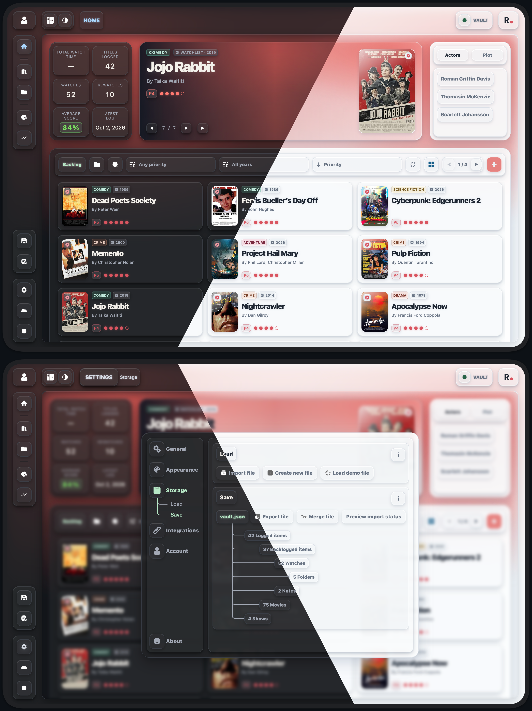

# ReWatched

A watch journal for films and shows. Log ratings and rewatches, organize your library and backlog, and explore timelines and statistics.

<p align="center">
  <picture>
    <source media="(prefers-color-scheme: dark)" srcset="assets/previews/app-preview-dark.jpg">
    <source media="(prefers-color-scheme: light)" srcset="assets/previews/app-preview-light.jpg">
    
  </picture>
</p>

## Run

With Node.js installed, start the desktop app:

```sh
npm install
npm start
```

For the web version, open `index.html` or run `python3 -m http.server 8000` and visit <http://localhost:8000>. It is also available on [GitHub Pages](https://tardz.github.io/Rewatched/).

## Data

Entries are stored in the browser by default. In Settings, you can import or export JSON files and, in supported browsers, save directly to a linked file. Poster search and movie details can optionally use Google Programmable Search and OMDb.

## Copyright and third-party assets

© 2026 Jonathan Almstedt. All rights reserved.

This project’s code and original assets may not be used, copied, modified, or distributed without permission. Viewing or forking the public repository through GitHub does not grant permission for commercial use or other use beyond GitHub’s permitted functionality.

Some icons used in Rewatched are from Flaticon, see sample below. See [CREDITS.md](CREDITS.md) for full creator attributions.

<p align="center">
  
  &nbsp;&nbsp;
  
  &nbsp;&nbsp;
  
  &nbsp;&nbsp;
  
  &nbsp;&nbsp;
  
  &nbsp;&nbsp;
  
</p>
