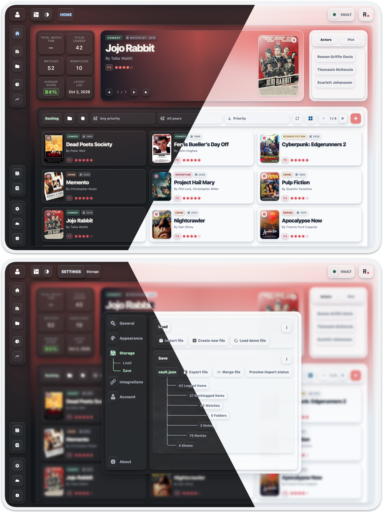

# ReWatched

A watch journal for films and shows. Log ratings and rewatches, organize your library and backlog, and explore timelines and statistics.

<p align="center">
  <a href="assets/previews/app-preview.png"></a>
</p>

## Run

With Node.js installed, start the desktop app:

```sh
npm install
npm start
```

For the web version, open `index.html` or run `python3 -m http.server 8000` and visit <http://localhost:8000>. It is also available on [GitHub Pages](https://tardz.github.io/Rewatched/).

## Data

Entries are stored in the browser by default. In Settings, you can import or export JSON files and, in supported browsers, save directly to a linked file. Poster search and movie details can optionally use Google Programmable Search and OMDb.
